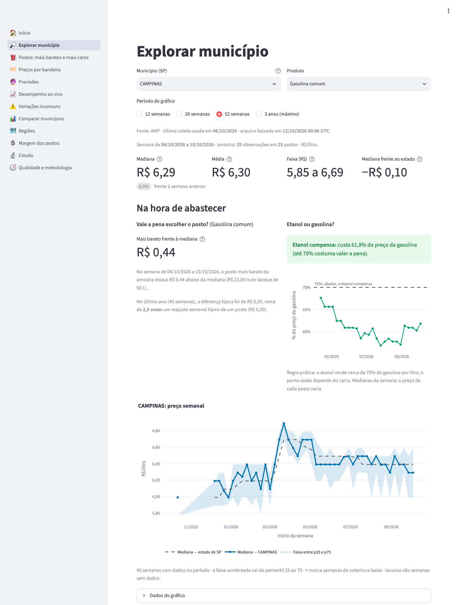
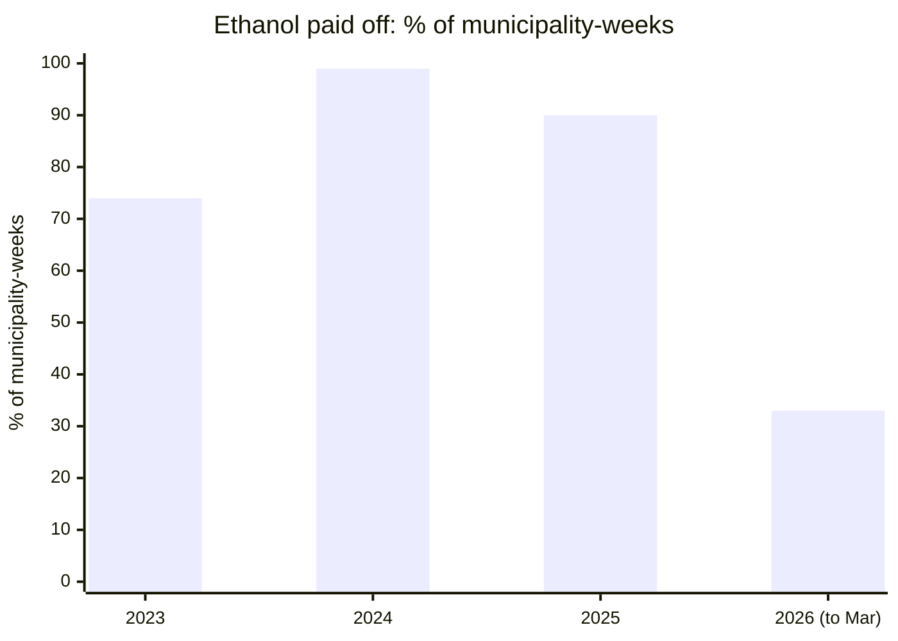
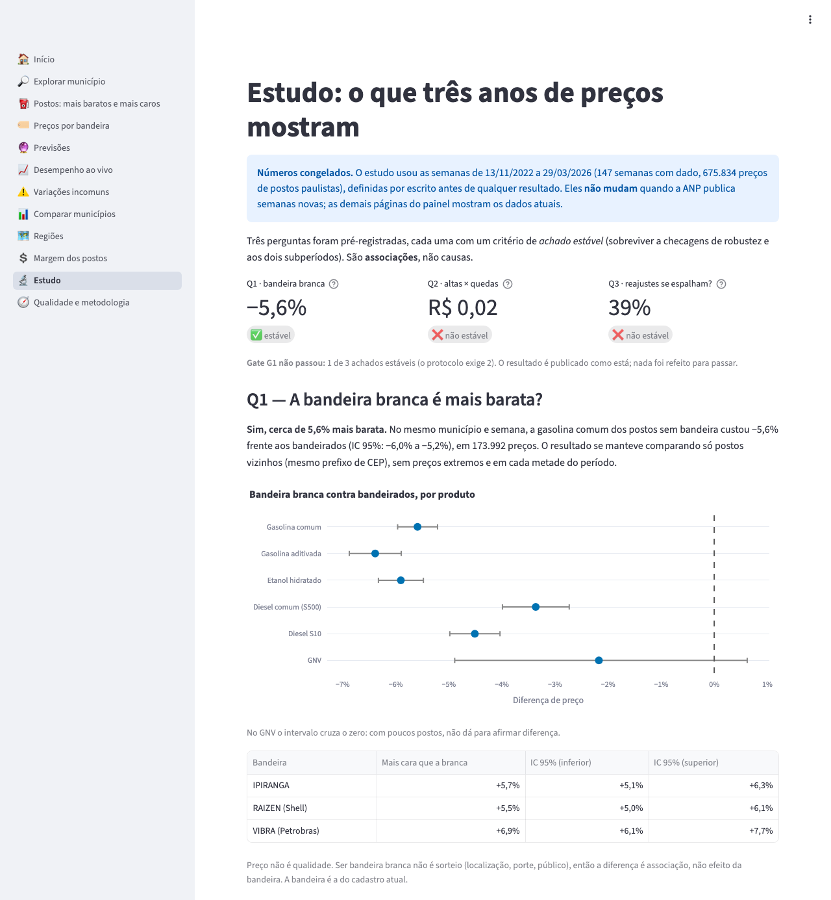
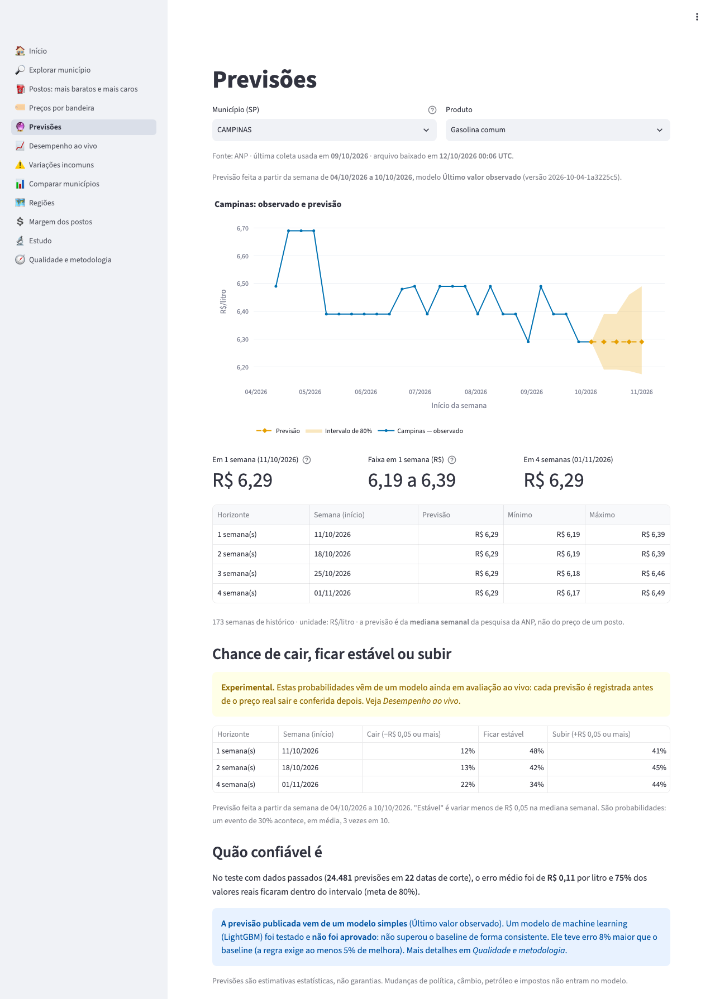

# Radar de Combustíveis SP

Fuel prices surveyed by ANP (Brazil's National Petroleum Agency) in the state of São Paulo, organized to answer practical questions (*where to fill up, ethanol or gasoline, how much the price will change*) and tested with a pre-registered study.

**[Live demo](https://fuelradar-a5kwciypheseufpbfh6ggv.streamlit.app/)** (interface in Portuguese) · data from 2022-11-13 to 2026-10-09 (latest collection) · nothing to install · [Português](README.md)

## The problem

Every week ANP publishes prices from about 1,200 São Paulo stations (4,000 different ones over three years) in loose spreadsheets, with gaps and format changes. You can look up a file, but you cannot ask "how much do I save by choosing the station in my town?" or "are unbranded stations really cheaper?". This project joins three years of those spreadsheets, takes care of quality, and answers with the source, the date and the sample size always in view.



*Campinas, regular gasoline, week of 2026-10-04: the cheapest station in the sample was R$ 0.44/L below the median, and ethanol cost 61.8% of gasoline.*

## What the data shows

Numbers from the [study](reports/study/resumo.md), over 2022-11-13 to 2026-03-29 (675,834 prices), with methods and criteria written and committed **before** any result was computed.

1. **Choosing the station matters more than waiting a week.** In the same municipality and week, the cheapest station in the sample is typically **R$ 0.40/L** below the median (R$ 20 on a 50 L tank), about **4 times** a station's typical weekly price change (R$ 0.10). [Report](reports/study/descritivo.md)
2. **Unbranded stations are about 5.6% cheaper**, comparing stations in the same municipality and week (95% CI −6.0% to −5.2%). The result survived every check (neighbourhood by postcode, no extreme prices, each half of the period). It is a price association, not an effect of the brand and not a measure of quality. [Report](reports/study/q1.md)
3. **Ethanol paid off (at most 70% of the gasoline price) in 83% of each municipality's weeks**, but this changes a lot over time:





## What did not work (and is published anyway)

- **Machine learning did not beat the obvious.** A LightGBM forecasting the weekly median 1 to 4 weeks ahead was **7.9% worse** than "repeat the last value" in a backtest with 24,481 forecasts. The published forecast is the simple method, and the [model card](docs/en/model-card.md) explains why.
- **The second forecasting attempt came close, but did not pass.** Predicting whether the median will fall, stay or rise in 2 weeks, the best model (LightGBM with statewide signals) beat the base rate by **16%** on the final test, read only once ([report](reports/modelv2/final.md)). But the pre-registered rule also requires well-calibrated probabilities (error up to 0.05), and it had **0.0504**. It was not approved, and nothing changed in the product. Statewide signals helped; the series itself and the dollar/producer prices added nothing.
- **Two of the study's three hypotheses did not hold.** "Prices rise more than they fall" (Q2) and "price moves start in the big cities" (Q3) did not survive the subperiods. Per the protocol, the gate that would unlock the more ambitious modelling **did not pass** (1 of 3), and nothing was redone to make it pass.

**In progress:** the second attempt's model, with recalibrated probabilities, records every week the chance of a fall, no change or a rise **before** ANP publishes prices, in a file that is never altered. The decision (official or withdrawn) comes on its own with 26 scored weeks, around April 2027, under the rule [written before the first forecast](docs/estudo/protocolo-ao-vivo.md). Until then the dashboard labels these probabilities as experimental.



## How it was built

```text
ANP (weekly spreadsheets) → ingestion (SHA-256 manifest, raw files untouched) → quality (rules, quarantine)
  → PostgreSQL (dimensions, facts, aggregates) → read-only FastAPI → Streamlit dashboard
                                              ↘ pre-registered study and forecasts (backtest)
```

- **Data:** about 800 thousand prices over 174 weeks, from 108 municipalities. Re-runs without duplication, source revisions tracked, defective ANP files excluded with a record (ADR 0006).
- **API:** read-only endpoints with `data_as_of`, sample and coverage in every response, read-only database user.
- **Dashboard:** 12 pages: home, municipality, cheapest stations, brands, forecasts, live performance, unusual changes, comparison, regions, station margins, study and quality.
- **Live evaluation:** every week, before prices come out, the probabilities of a fall, no change and a rise are written to a ledger that is never altered; the scoreboard checks them when ANP publishes, and the decision on the model comes with 26 scored weeks ([protocol](docs/estudo/protocolo-ao-vivo.md)).
- **Operations:** tests on every push and a weekly update that runs on its own in GitHub Actions, on a temporary database opened from an encrypted state, at no cost ([operations manual](docs/en/operations.md)). [Dataset card](docs/en/dataset-card.md) and `scripts/reproduce.py`, which regenerates and checks the reports.
- **External sources:** US dollar from the Central Bank and ANP producer and distributor prices, each with the date it became available, so the modelling never uses future data. With distributor prices, the dashboard shows the **gross retail margin**: how far the station price sits above the average distributor price.
- **Study:** [protocol](docs/estudo/protocolo.md) committed before the results, final test sealed in code, station-clustered CIs, week-block bootstrap and Holm correction.
- **Tests:** suite with synthetic data of known answer, against a real PostgreSQL in Docker; dashboard numbers were checked against separately written SQL, and the screens in a browser.
- **Demo:** the same dashboard reading a package of API responses, with no CNPJ (company tax ID) or company name.

Methods, results and limitations in one place: [technical report](docs/en/technical-report.md). Protocols, decisions (`docs/decisions/`), guides and the milestone log ([PLAN.md](PLAN.md)) are in Portuguese.

## Run it locally

Requirements: Python 3.14 (the tested version, on Windows, macOS and GitHub Actions) and, for the database, Docker. On macOS or Linux, from the repository root:

```bash
python3.14 -m venv .venv
.venv/bin/python -m pip install -r requirements.txt   # pinned environment
cp .env.example .env                                   # set POSTGRES_PASSWORD (and DATABASE_URL with the same password)
docker compose up -d --wait                            # PostgreSQL on 127.0.0.1:54329
```

**On Windows (PowerShell)**, the same steps with `python -m venv .venv`, `.\.venv\Scripts\python.exe` instead of `.venv/bin/python`, `Copy-Item` instead of `cp`, and the `.ps1` scripts instead of the `.sh` ones (`.\iniciar.ps1`, `.\atualizar.ps1`).

**Dashboard only, no database or API** (reads the demo package; no Docker needed):

```bash
.venv/bin/python -m streamlit run demo/streamlit_app.py      # http://127.0.0.1:8501
```

**Full pipeline** (raw files are not in Git; the download fetches ANP's weeks). Scripts read the connection from `DATABASE_URL` in the environment, not from `.env`; `iniciar.sh` and `atualizar.sh` set the variables themselves:

```bash
export DATABASE_URL="postgresql://radar:$(grep '^POSTGRES_PASSWORD=' .env | cut -d= -f2-)@127.0.0.1:54329/radar"
.venv/bin/python scripts/fetch_anp.py --since 2026-09-01 --ingest   # download ANP weeks since that date and ingest
.venv/bin/python scripts/check_quality.py      # quality, quarantine and coverage
.venv/bin/python scripts/load_db.py            # migrate and load into PostgreSQL
.venv/bin/python scripts/run_forecasts.py      # backtest, decision and forecasts; report in reports/forecasting/
.venv/bin/python scripts/run_study.py          # study; reports in reports/study/
.venv/bin/python scripts/fetch_external.py     # dollar (BCB), producer and distributor prices (ANP): download, check, load
./iniciar.sh                                   # start database, API and dashboard (http://127.0.0.1:8501)
.venv/bin/python scripts/build_snapshot.py     # rebuild the demo package (API_DATABASE_URL)
```

**Every week**, after ANP publishes: `./atualizar.sh` downloads, ingests, checks, loads, refreshes external sources, forecasts, the live forecast (`scripts/run_live.py`) and the package, only if there is a new week; it stops at the first failure and names the stage. `./atualizar.sh --dry-run` only says whether there is a new week. In the public repository this already runs on its own in GitHub Actions.

Without `--since`, `fetch_anp.py` downloads every week since 2022 (about 300 MB); use `--dry-run` to see what would be downloaded. The API's read-only user is created by `scripts/create_api_role.py`. Tests: `.venv/bin/python -m unittest discover -s tests -t .`; with `RADAR_TEST_DATABASE_URL` (the same URL, ending in `/postgres`) the database, API and integration tests run too.

## Data source

Prices come from ANP's **Levantamento de Preços de Combustíveis** (fuel price survey), and producer and distributor prices from ANP's price pages ([gov.br/anp](https://www.gov.br/anp/pt-br/assuntos/precos-e-defesa-da-concorrencia/precos)). The [ANP portal's terms of use](https://www.gov.br/anp/pt-br/acesso-a-informacao/termos-de-uso-privacidade-e-seguranca-1) allow **non-commercial** reproduction with attribution; this project is non-commercial. The US dollar rate comes from the **Central Bank of Brazil** (SGS, series 1), under the [ODbL](https://opendatacommons.org/licenses/odbl/); it is not included in the public demo package. The original files are **not** in this repository. Medians, comparisons, forecasts, margins and other numbers are **derived by this project** and are not published by ANP or the Central Bank.

## Limits

- It is a **sample survey**: it does not cover every station or give real-time prices, and the price may have changed after collection.
- Only **São Paulo** is published; the structure allows other states (`TARGET_UFS`).
- Unusual changes are statistical signals, not evidence of wrongdoing; no screen links stations to fuel quality.
- Forecasts are estimates with uncertainty, not price guarantees.

## Layout

- `src/radar_combustiveis/`: ingestion, quality, database, API (`api/`), dashboard (`dashboard/`), forecasting (`forecasting/`), study (`study/`), external sources (`external/`), modelling v2 and live evaluation (`modelv2/`) and the weekly routine (`weekly.py`).
- `scripts/`: entry points (download, ingestion, quality, load, forecasts, study, API, dashboard, package, weekly routine, encrypted state and reproduction).
- `iniciar.sh` and `atualizar.sh` (macOS and Linux), `iniciar.ps1` and `atualizar.ps1` (Windows): start everything and run the weekly routine on your computer.
- `migrations/`: PostgreSQL schema as versioned SQL.
- `reports/`: reproducible reports for the backtest, the study, modelling v2 and the dataset card; `reports/ledger/` is the immutable live-forecast ledger and scoreboard.
- `snapshot/` and `demo/`: the demo package and entry point.
- `docs/`: technical report, architecture, case-study design, protocols (`estudo/`), contracts, guides, decisions and screenshots (`img/`); `docs/en/` has the English technical report, model card, dataset card and operations manual.
- `tests/`: tests with synthetic data.
- `.github/workflows/`: tests and workflow validation on every push; weekly update.

## License

Code under the [MIT](LICENSE) license. Source data and the numbers derived from it follow each source's terms: ANP's allow non-commercial use with attribution.
