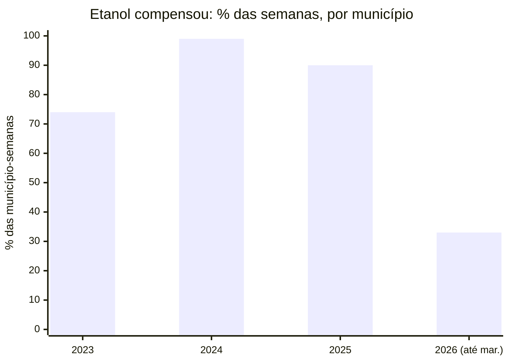

# Radar de Combustíveis SP

Preços de combustível pesquisados pela ANP em São Paulo, organizados para responder perguntas práticas (*onde abastecer, etanol ou gasolina, quanto o preço vai mudar*) e testados com um estudo pré-registrado.

**[Demonstração online](https://fuelradar-a5kwciypheseufpbfh6ggv.streamlit.app/)** · dados de 13/11/2022 a 09/10/2026 (última coleta) · sem instalar nada.

## O problema

A ANP publica toda semana o preço de cerca de 1.200 postos paulistas (4 mil diferentes em três anos), em planilhas soltas, com lacunas e mudanças de formato. Dá para consultar um arquivo, mas não para perguntar "quanto economizo escolhendo o posto na minha cidade?" ou "a bandeira branca é mesmo mais barata?". Este projeto junta três anos dessas planilhas, cuida da qualidade e responde com a fonte, a data e o tamanho da amostra sempre à vista.

## O que os dados mostram

Números do [estudo](reports/study/resumo.md), na janela de 13/11/2022 a 29/03/2026 (675.834 preços), com métodos e critérios escritos e commitados **antes** de calcular qualquer resultado.

1. **Escolher o posto pesa mais do que esperar a semana.** No mesmo município e semana, o posto mais barato da amostra fica tipicamente **R$ 0,40/L** abaixo da mediana (R$ 20 num tanque de 50 L), cerca de **4 vezes** um reajuste semanal típico de um posto (R$ 0,10). [Relatório](reports/study/descritivo.md)
2. **A bandeira branca é cerca de 5,6% mais barata**, comparando postos do mesmo município na mesma semana (IC 95% de −6,0% a −5,2%). O resultado sobreviveu a todas as checagens (vizinhança por CEP, sem preços extremos, cada metade do período). É associação de preço, não efeito da bandeira nem medida de qualidade. [Relatório](reports/study/q1.md)
3. **O etanol compensou (até 70% da gasolina) em 83% das semanas de cada município**, mas isso muda muito com o tempo:



## O que não funcionou (e está publicado assim mesmo)

- **Machine learning não superou o óbvio.** Um LightGBM para prever a mediana semanal de 1 a 4 semanas ficou **7,9% pior** que "repetir o último valor" num backtest com 24.481 previsões. A previsão publicada é a do método simples, e o [cartão do modelo](docs/model-card.md) explica por quê.
- **A segunda tentativa de previsão ficou perto, mas não passou.** Prevendo se a mediana vai cair, ficar ou subir em 2 semanas, o melhor modelo (LightGBM com sinais do estado) superou a taxa-base em **16%** no teste final, lido uma única vez ([relatório](reports/modelv2/final.md)). Mas a regra pré-registrada também exige probabilidades bem calibradas (erro até 0,05), e ele teve **0,0504**. Não foi aprovado, e nada mudou no produto. O que ajudou foram os sinais do estado; a própria série e o dólar/preço de produtores não acrescentaram ganho.
- **Duas das três hipóteses do estudo não se sustentaram.** "O preço sobe mais do que cai" (Q2) e "os reajustes começam nas cidades grandes" (Q3) não sobreviveram aos subperíodos. Pelo protocolo, o gate que liberaria a modelagem mais ambiciosa **não passou** (1 de 3), e nada foi refeito para passar.

## Como foi feito

```text
ANP (planilhas semanais) → ingestão (manifesto SHA-256, brutos intactos) → qualidade (regras, quarentena)
  → PostgreSQL (dimensões, fatos, agregações) → API FastAPI somente leitura → painel Streamlit
                                              ↘ estudo pré-registrado e previsões (backtest)
```

- **Dados:** cerca de 800 mil preços em 174 semanas, de 108 municípios. Reexecução sem duplicar, revisões da fonte rastreadas, arquivos com defeito da ANP excluídos com registro ([ADR 0006](docs/decisions/0006-arquivos-da-fonte-excluidos.md)).
- **API:** endpoints de leitura com `data_as_of`, amostra e cobertura em cada resposta, usuário de banco somente leitura ([guia](docs/api.md)).
- **Painel:** 12 páginas: início, município, postos mais baratos, bandeiras, previsões, desempenho ao vivo, variações incomuns, comparação, regiões, margem dos postos, estudo e qualidade ([guia](docs/dashboard.md)).
- **Avaliação ao vivo:** toda semana, antes de o preço sair, as probabilidades de queda, estabilidade e alta são gravadas num registro que não se altera; o placar confere quando a ANP publica, e a decisão sobre o modelo sai com 26 semanas conferidas ([protocolo](docs/estudo/protocolo-ao-vivo.md)).
- **Operação:** testes a cada push e atualização semanal sozinha no GitHub Actions, num banco temporário aberto a partir de um estado cifrado, sem custo ([ADR 0011](docs/decisions/0011-rotina-semanal-no-ci.md)). [Ficha do conjunto de dados](docs/ficha-dados.md) e `scripts/reproduce.py`, que refaz e confere os relatórios.
- **Fontes externas:** dólar do Banco Central e preços de produtores e de distribuição da ANP, com a data em que cada valor ficou disponível, para a modelagem não usar dado do futuro ([ADR 0010](docs/decisions/0010-fontes-externas-e-as-of.md)). Com a distribuição, o painel mostra a **margem bruta de revenda**: quanto o preço nos postos fica acima do preço médio das distribuidoras.
- **Estudo:** [protocolo](docs/estudo/protocolo.md) commitado antes dos resultados, teste final lacrado em código, IC agrupado por posto, bootstrap em blocos de semanas e correção de Holm.
- **Testes:** suíte com dados sintéticos de resposta conhecida, contra PostgreSQL real em Docker; os números do painel foram conferidos contra SQL escrito à parte e as telas, no navegador.
- **Demonstração:** o mesmo painel lendo um pacote de respostas da API ([ADR 0009](docs/decisions/0009-demonstrativo-e-pacote-instantaneo.md)), sem CNPJ nem razão social.

Decisões em [docs/decisions/](docs/decisions/), marcos e evidências em [PLAN.md](PLAN.md).

## Rodar localmente

Requisitos: Python 3.14 (a versão testada, aqui e no GitHub Actions) e Docker. No PowerShell, a partir da raiz:

```powershell
python -m venv .venv
.\.venv\Scripts\python.exe -m pip install -r requirements.txt   # ambiente fixado
Copy-Item .env.example .env                                         # defina POSTGRES_PASSWORD
docker compose up -d --wait                                         # PostgreSQL em 127.0.0.1:54329
```

**Só o painel, sem banco nem API** (lê o pacote do demonstrativo):

```powershell
.\.venv\Scripts\python.exe -m streamlit run demo/streamlit_app.py
```

**Pipeline completo** (os dados brutos não acompanham o Git; o download baixa as semanas da ANP):

```powershell
.\.venv\Scripts\python.exe scripts/fetch_anp.py --since 2026-09-01 --ingest   # baixa as semanas da ANP desde essa data e ingere
.\.venv\Scripts\python.exe scripts/check_quality.py             # qualidade, quarentena e cobertura
.\.venv\Scripts\python.exe scripts/load_db.py                   # migra e carrega no PostgreSQL (DATABASE_URL)
.\.venv\Scripts\python.exe scripts/run_forecasts.py              # backtest, decisão e previsões; relatório em reports/forecasting/
.\.venv\Scripts\python.exe scripts/run_study.py                  # estudo; relatórios em reports/study/
.\.venv\Scripts\python.exe scripts/fetch_external.py             # dólar (BCB), produtores e distribuição (ANP): baixa, confere e carrega
.\iniciar.ps1                                                    # sobe banco, API e painel (http://127.0.0.1:8501)
.\.venv\Scripts\python.exe scripts/build_snapshot.py            # regenera o pacote do demonstrativo (API_DATABASE_URL)
```

**Toda semana**, depois que a ANP publica: `.\atualizar.ps1` baixa, ingere, confere, carrega, atualiza as fontes externas, as previsões, a previsão ao vivo (`scripts/run_live.py`) e o pacote, só se houver semana nova; para na primeira falha e diz em qual etapa. `.\atualizar.ps1 --dry-run` só diz se há semana nova.

Sem `--since`, `fetch_anp.py` baixa todas as semanas desde 2022 (cerca de 300 MB); use `--dry-run` para ver o que seria baixado. O usuário somente leitura da API é criado por `scripts/create_api_role.py` ([docs/api.md](docs/api.md)). Testes: `.\.venv\Scripts\python.exe -m unittest discover -s tests -t .`, e com `RADAR_TEST_DATABASE_URL` rodam também os de banco, API e integração.

## Fonte dos dados

Os preços vêm do **Levantamento de Preços de Combustíveis da ANP** (Agência Nacional do Petróleo, Gás Natural e Biocombustíveis), e os preços de produtores e de distribuição, das páginas de preços da ANP ([gov.br/anp](https://www.gov.br/anp/pt-br/assuntos/precos-e-defesa-da-concorrencia/precos)). Os [termos de uso do portal da ANP](https://www.gov.br/anp/pt-br/acesso-a-informacao/termos-de-uso-privacidade-e-seguranca-1) autorizam a reprodução **sem fins lucrativos**, com citação da fonte; este projeto não tem fins lucrativos. O dólar vem do **Banco Central do Brasil** (SGS, série 1), sob a [ODbL](https://opendatacommons.org/licenses/odbl/); ele não entra no pacote público do demonstrativo. Os arquivos originais **não** estão neste repositório. Medianas, comparações, previsões, margens e demais números são **derivados por este projeto** e não são divulgados pela ANP nem pelo BCB.

## Limites

- É uma **pesquisa por amostragem**: não cobre todos os postos nem dá preço em tempo real, e o preço pode ter mudado depois da coleta.
- Só **São Paulo** é publicado; a estrutura prevê outras UFs (`TARGET_UFS`).
- Variações incomuns são sinais estatísticos, não indício de irregularidade; nenhuma tela associa postos a qualidade do combustível.
- Previsões são estimativas com incerteza, sem garantia de preço.

## Organização

- `src/radar_combustiveis/`: ingestão, qualidade, banco, API (`api/`), painel (`dashboard/`), previsão (`forecasting/`), estudo (`study/`), fontes externas (`external/`), modelagem v2 e avaliação ao vivo (`modelv2/`) e rotina semanal (`weekly.py`).
- `scripts/`: pontos de entrada (download, ingestão, qualidade, carga, previsões, estudo, API, painel, pacote, rotina semanal, estado cifrado e reprodução).
- `migrations/`: esquema do PostgreSQL em SQL versionado.
- `reports/`: relatórios reproduzíveis do backtest, do estudo, da modelagem v2, da ficha dos dados e do perfil inicial; `reports/ledger/` é o registro imutável das previsões ao vivo e o placar.
- `snapshot/` e `demo/`: pacote e ponto de entrada do demonstrativo.
- `docs/`: arquitetura, [desenho do estudo de caso](docs/estudo-de-caso.md), contratos, guias e decisões.
- `tests/`: testes com dados sintéticos.
- `.github/workflows/`: testes e validação dos workflows a cada push; atualização semanal.

## Licença

Código sob a licença [MIT](LICENSE). Os dados de origem e os números derivados deles seguem os termos de cada fonte: os da ANP permitem uso sem fins lucrativos, com citação.
